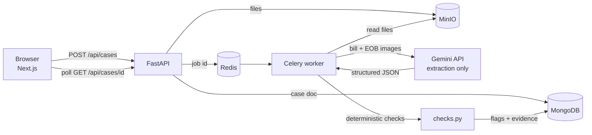

# Bill Reconciler

Compare a medical provider bill with its insurance explanation of benefits (EOB) and flag the differences. Every finding cites the printed row it came from.

> **Status: working prototype, tested on synthetic documents only. User demand has not been validated.**
> It is not medical, legal or billing advice. Do not upload real health records (see [Privacy](#privacy)).

## Contents

- [How it works](#how-it-works)
- [Design decisions](#design-decisions)
- [Does the AI earn its place?](#does-the-ai-earn-its-place)
- [Tech stack](#tech-stack)
- [Run it locally](#run-it-locally)
- [API](#api)
- [Testing and security checks](#testing-and-security-checks)
- [Privacy](#privacy)
- [Limitations](#limitations)
- [Roadmap](#roadmap)
- [Repository guide](#repository-guide)

## How it works

1. You upload a bill and an EOB (PNG, JPEG, WebP or PDF, up to 10 MB each).
2. The API stores the files and queues a background job, so the request returns immediately.
3. A worker sends both documents to a Gemini vision model in one request. It returns line items, totals, the amount owed and the EOB patient amount as JSON in a fixed schema.
4. Plain Python checks (no AI) look for three problems:
   - line items that do not add up to the stated total (`sum_mismatch`);
   - the same charge appearing twice (`duplicate_line`);
   - the bill asking the patient for a different amount than the EOB (`eob_mismatch`).
5. The result page shows each flag with its evidence, plus the extracted line items.



## Design decisions

- **AI extracts, code judges.** A language model can misread or invent things, but arithmetic must be exact. Keeping the model to extraction makes every flag deterministic, unit-testable and explainable.
- **Evidence guard.** The model returns the text of each row it used. It is kept only if it contains that line's code or amount; otherwise the UI labels it "reconstructed, not a quote". This was added after an end-to-end run showed the model citing the word "bill" instead of the row.
- **One request per case.** Both images go in a single call with a combined JSON schema, because the free tier allows about 20 requests per day per model.
- **Quota counted honestly.** Retries count against Google's limit, and the limit is per model, so the local counter is kept per model and counts every attempt.
- **Background processing.** Extraction takes about 10 seconds, so a Celery worker does it and the frontend polls for status.
- **Dependency injection.** The API gets its repository, storage and job queue through FastAPI dependencies, so tests use in-memory fakes and need no Docker.

## Does the AI earn its place?

The workspace rule is that AI must beat a simpler non-AI baseline, so this was measured. Documents are synthetic with known ground truth and injected errors. The baselines use free OCR (RapidOCR) plus regex, one of them with page deskewing.

Hard set, 30 cases (tilt, blur, noise, varied date and code formats). Full detail and caveats are in [docs/GATE1_RESULTS.md](docs/GATE1_RESULTS.md).

| Extractor | Line F1 | Flags exactly right | Injected errors found | False alarms on clean bills |
|---|---|---|---|---|
| OCR + regex | 0.697 | 63% | 20 / 22 | 6 of 8 |
| OCR + regex + deskew | 0.914 | 77% | 21 / 22 | 4 of 8 |
| Gemini 2.5 Flash | 0.970 | 100% | 22 / 22 | 0 of 8 |

What this does and does not show:

- On clean, uniform documents a free OCR + regex pipeline is already perfect, so AI is unnecessary there.
- On messy documents Gemini is clearly better end to end, but its lead on line F1 over a decent baseline is only +5.6 points, below the +10 the project plan asked for. A more heavily engineered baseline could close more of the gap.
- Gemini silently altered a code in 3 of 101 lines, which is why the UI asks users to verify against the original.
- The hard set was designed after seeing the easy one. Treat the numbers as a stress test, not real-world accuracy.

## Tech stack

| Layer | Technology |
|---|---|
| Frontend | Next.js 16, React 19, TypeScript, plain CSS (light and dark), lucide icons. Responsive from phone to desktop. |
| API | FastAPI, Pydantic settings |
| Background jobs | Celery with Redis as broker and result backend |
| Data | MongoDB (cases), MinIO (uploaded files) |
| AI | Gemini API, free tier, via plain REST |
| Baseline and evaluation | RapidOCR, Pillow-based synthetic document generator, scoring harness |
| Tooling | Docker Compose, pytest, pip-audit, npm audit |

## Run it locally

Needs Python 3.13, Node 22, Docker and a free Gemini API key.

```
cp .env.example .env            # set GEMINI_API_KEY; .env is git-ignored
docker compose up -d            # MongoDB, Redis (host port 6380), MinIO

cd backend
python -m venv .venv && .venv/Scripts/python -m pip install -r requirements.txt
.venv/Scripts/python -m uvicorn app.main:app --port 8000
.venv/Scripts/python -m celery -A app.worker.celery_app worker --pool=solo --loglevel=info

cd ../frontend
npm install && npm run dev      # http://localhost:3000
```

Notes:

- If port 3000 is busy, run the web app on 3100 (`npx next start -p 3100`). The API allows both origins; set `CORS_ORIGINS` to change them.
- On Linux or macOS use `.venv/bin/python` and drop `--pool=solo`.
- Configuration lives in `.env` (see `.env.example`): `GEMINI_API_KEY`, `GEMINI_MODEL`, and the Mongo, Redis and MinIO settings. `GEMINI_DAILY_CAP` (default 20) is an optional override for the local request cap.

Generate sample documents and run the evaluation:

```
cd backend
python -m app.synthetic ../data/generated/demo 8 1 hard
python -m app.evaluate ../data/generated/demo --extractor baseline_deskew
python -m app.evaluate ../data/generated/demo --extractor gemini --model gemini-2.5-flash-lite
```

## API

| Method and path | Purpose |
|---|---|
| `GET /health` | Liveness check |
| `POST /api/cases` | Upload `bill` and `eob` files (multipart). Returns `202` with the case id. Rejects unsupported types (415), oversize files (413) and empty files (400). |
| `GET /api/cases` | List cases |
| `GET /api/cases/{id}` | One case: status, extracted bill and EOB, flags with evidence, any error |

Case status moves from `queued` to `processing` to `done` or `failed`.

## Testing and security checks

```
cd backend  && python -m pytest -q            # 43 tests
cd frontend && npx tsc --noEmit               # type check
cd backend  && python -m pip_audit -r requirements.txt
cd frontend && npm audit
```

The tests cover the Gemini client (retries, errors, per-model quota caps), the deterministic checks, the API and pipeline with in-memory fakes, extraction and the evidence guard, the synthetic generator, and the baseline and scoring code. Dependency audits were clean on 2026-11-01. Secrets stay in `.env`, which is git-ignored.

## Privacy

The free Gemini tier may retain and human-review submitted content, and Google's terms say not to submit sensitive or personal data. Use this project only with synthetic or fully redacted documents. Automatic redaction before the API call is planned but not built yet.

## Limitations

- Tested on synthetic documents only. Real bills are messier, so the accuracy figures above are not real-world estimates.
- User demand has not been validated. This is a portfolio project.
- The free tier allows roughly 20 cases per day per model.
- US medical bills only, English only, three checks only. No coding or bundling rules, no appeals, no user accounts.
- Not deployed.
- No open-source licence has been chosen yet.

## Roadmap

- [ ] Score the last two hard cases and a second Gemini model (flash-lite) on the same 32 cases when free quota allows.
- [ ] Redact personal data before any API call, with tests.
- [ ] Improve the baseline's long-date handling and re-measure the AI margin.
- [ ] UI polish and clearer error states.
- [ ] Add a screenshot or short demo recording.

## Repository guide

- `backend/app`: API, pipeline, Gemini client, extraction, checks, baseline, evaluation, synthetic data
- `backend/tests`: pytest suite
- `frontend`: Next.js web app
- `docker-compose.yml`: MongoDB, Redis, MinIO
- `docs/GATE1_RESULTS.md`: the AI-versus-baseline evaluation
- `PRODUCT_RESEARCH.md`, `VALIDATION_PLAN.md`, `PLAN.md`: research, validation gates and status
